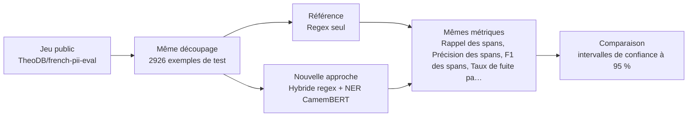
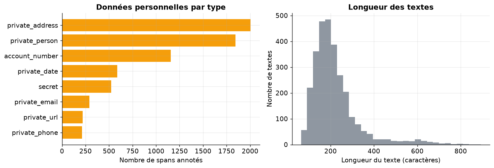
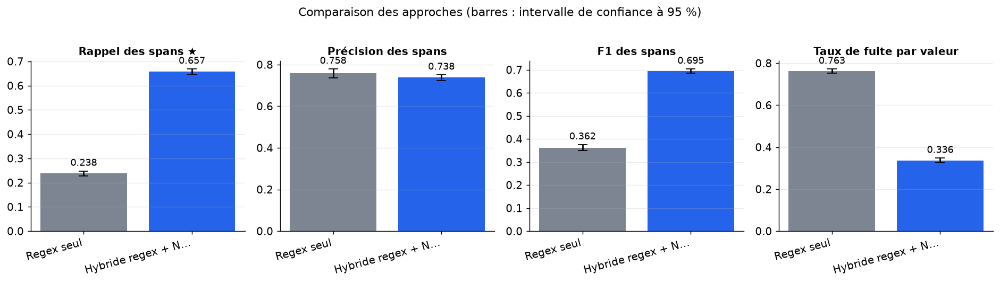
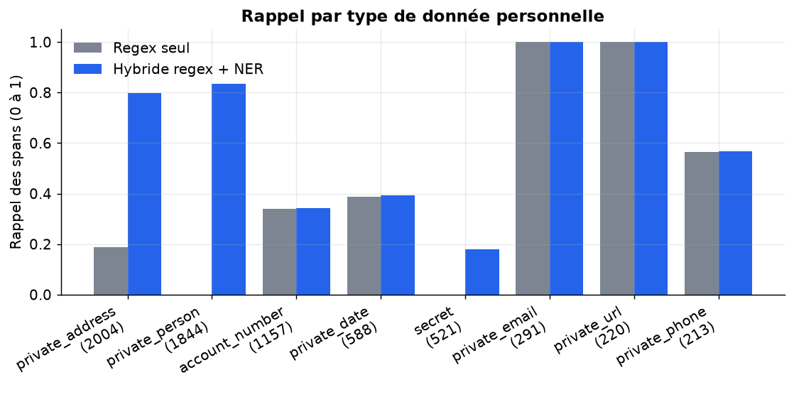
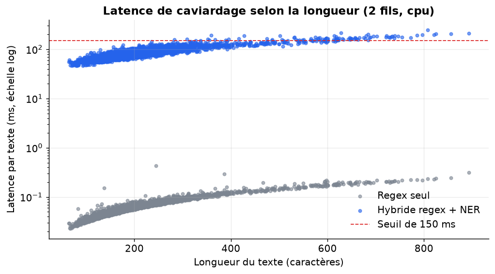
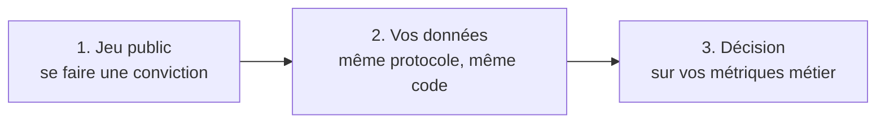

# Un caviardage hybride regex + NER français détecte-t-il nettement plus de données personnelles que le regex seul sur du texte français, et à quelle latence ?

> **En bref.** Le NER français améliore nettement le caviardage par rapport aux regex seules, surtout pour les noms et adresses. Mais il laisse encore fuir une part importante de données, notamment des secrets, comptes et dates : il ne suffit pas seul. Rappel des spans : 0,657 [0,646 ; 0,669] pour Hybride regex + NER CamemBERT, contre 0,238 [0,228 ; 0,248] pour Regex seul (2926 exemples de test, échelle complète).

## Sommaire

1. [La question](#la-question)
2. [Le protocole](#le-protocole)
3. [Les résultats](#les-résultats)
4. [Ce qu'il faut retenir](#ce-quil-faut-retenir)
5. [Rejouer l'expérience](#rejouer-lexpérience)
6. [Contenu du dépôt](#contenu-du-dépôt)
7. [Références](#références)
8. [Glossaire](#glossaire)

## La question

Avant d'envoyer un texte à un grand modèle de langage, on veut en retirer les données personnelles : noms, e-mails, téléphones, IBAN, adresses. Cette expérience compare deux façons de le faire sur des textes français annotés. La première n'utilise que des règles de format (expressions régulières). La seconde ajoute un modèle français de reconnaissance d'entités, qui repère les noms de personnes et de lieux. On mesure la part des données personnelles trouvées, la part des zones caviardées à raison et le temps ajouté par texte. La comparaison dit si le modèle vaut son coût en latence et sur quels types de données il apporte un gain.

**Hypothèse testée.** Sur du texte français annoté, le regex seul a un rappel de spans inférieur à 60 % (noms et adresses non détectés) alors que regex + NER CamemBERT dépasse 80 % de rappel, avec une latence médiane inférieure à 150 ms par document sur 2 cœurs CPU, et une précision supérieure à 70 %.

| | Référence | Nouvelle approche |
|---|---|---|
| **Approche** | Regex seul | Hybride regex + NER CamemBERT |
| **Principe** | Expressions régulières pour e-mails, téléphones français, IBAN, URL, dates jj/mm/aaaa, sans modèle. | Les regex captent les formats rigides ; un modèle de reconnaissance d'entités nommées français trouve personnes et lieux ; fusion des spans. |
| **Mise en œuvre** | Module re de Python, motifs adaptés au français (IBAN FR, +33/0X XX XX XX XX), fusion des spans, remplacement par jetons typés. | Pipeline transformers token-classification (Jean-Baptiste/camembert-ner, agrégation simple) pour PER et LOC, combiné aux mêmes regex ; correspondance des types vers private_person, private_address, etc. ; mesure de la latence par document (médiane, p95) sur 2 cœurs. |
| **Modèles** | — | [`Jean-Baptiste/camembert-ner`](https://huggingface.co/Jean-Baptiste/camembert-ner) |

## Le protocole



- **Données** : [`TheoDB/french-pii-eval`](https://huggingface.co/datasets/TheoDB/french-pii-eval) (configuration `default`), évaluation sur le découpage `test` (2926 exemples). Seul jeu français chargeable avec spans typés (8 classes dont IBAN) et split de test séparé ; permet rappel, précision et latence par type.
- **Écarts avec des données réelles** : Textes synthétiques dérivés d'ai4privacy, noms et IBAN souvent étrangers, pas de conversations réelles, pas de termes métier à préserver, licence à valider ; le format exact des spans est contrôlé au chargement.
- **Déroulé** : On tire au hasard, avec la graine de l'expérience, des textes du split test de TheoDB/french-pii-eval (150 à l'échelle réduite, les 2 926 à l'échelle complète). Les deux approches traitent les mêmes textes, un à la fois, après quelques textes d'échauffement, avec 2 fils de calcul CPU. Une donnée annotée compte comme détectée si au moins 50 % de ses caractères sont caviardés. Une zone caviardée compte comme correcte si au moins 50 % de ses caractères tombent dans des données annotées. Le rappel, la précision, le F1 et le taux de fuite par valeur sont donnés avec des intervalles de confiance à 95 % obtenus par bootstrap sur les textes. On rapporte aussi le rappel par type, les latences médiane et p95, et une comparaison à deux prédicteurs triviaux (ne rien caviarder, tout caviarder).
- **Deux échelles, un seul code** : l'échelle réduite (150 exemples, CPU, 30 s) valide la mécanique ; l'échelle complète (CPU, 4 cœurs, 4 min) donne les résultats.



*À gauche, nombre de spans annotés par type de donnée personnelle dans l'échantillon de test ; à droite, distribution de la longueur des textes en caractères.*

**Les métriques**

| Métrique | Ce qu'elle mesure | Meilleur si |
|---|---|---|
| Rappel des spans ★ | Part des données personnelles annotées dont au moins la moitié des caractères a été caviardée. | plus haut |
| Précision des spans | Part des zones caviardées qui recouvrent pour au moins moitié une donnée personnelle annotée. | plus haut |
| F1 des spans | Moyenne harmonique du rappel et de la précision, qui résume les deux en un chiffre. | plus haut |
| Taux de fuite par valeur | Part des valeurs annotées encore présentes en toutes lettres dans le texte caviardé. | plus bas |
| Pire rappel par type | Rappel le plus faible parmi les types qui comptent au moins 10 données annotées. | plus haut |
| Latence médiane (ms) | Temps de caviardage d'un texte que la moitié des textes ne dépasse pas, en millisecondes. | plus bas |
| Latence p95 (ms) | Temps de caviardage que 95 % des textes ne dépassent pas, en millisecondes. | plus bas |

★ métrique principale : c'est elle qui tranche la question.

## Les résultats

| Approche | Rappel des spans ★ ↑ | Précision des spans ↑ | F1 des spans ↑ | Taux de fuite par valeur ↓ | Pire rappel par type ↑ | Latence médiane (ms) ↓ | Latence p95 (ms) ↓ | Latence médiane (ms) ↓ |
|---|---|---|---|---|---|---|---|---|
| Regex seul (référence) | 0,238 [0,228 ; 0,248] | **0,758 [0,737 ; 0,78]** | 0,362 [0,349 ; 0,376] | 0,763 [0,752 ; 0,773] | 0 | **0,06** | **0,14** | 0,06 |
| Hybride regex + NER CamemBERT (nouvelle approche) | **0,657 [0,646 ; 0,669]** | 0,738 [0,724 ; 0,751] | **0,695 [0,685 ; 0,704]** | **0,336 [0,325 ; 0,348]** | **0,18** | 77,9 | 137 | 77,9 |

★ métrique principale · ↑ plus haut = meilleur · ↓ plus bas = meilleur · entre crochets : intervalle de confiance à 95 % (bootstrap) · en gras : la meilleure valeur.



*Rappel, précision, F1 des spans et taux de fuite par valeur pour les deux approches, avec l'intervalle de confiance à 95 % (bootstrap sur les textes). Plus haut = mieux, sauf la fuite.*



*Part des PII annotées détectées, par type (effectif entre parenthèses), pour les regex seules et l'hybride. Un écart concentré sur les noms et les lieux montre l'apport du NER.*



*Latence de chaque texte selon sa longueur, pour les deux approches ; la ligne pointillée marque le seuil de 150 ms de l'hypothèse.*

**Lecture** (confiance elevee). À l'échelle complète (2 926 textes français annotés, CPU), l'hybride regex + NER CamemBERT atteint un rappel de 0,657 (IC 95 % 0,646–0,669) contre 0,238 (0,228–0,248) pour les regex seules : l'écart est net, les intervalles sont disjoints, et les deux approches sont évaluées sur les mêmes textes. La précision est comparable (0,738 contre 0,758), la latence médiane de 78 ms (p95 137 ms) reste sous 150 ms pour des textes courts. L'hypothèse n'est toutefois qu'en partie confirmée : le rappel de 80 % n'est pas atteint, 34 % des valeurs fuitent encore, et le pire rappel par type est de 0,18 (secrets). Le gain vient presque entièrement des noms et adresses ; comptes, dates et téléphones ne progressent pas. Les chiffres absolus sont à lire avec prudence, car les annotations du jeu synthétique sont bruitées. Ils ne sont pas comparables à ceux de la source (100 % contre 88,9 % sur des CV anglais), seule la direction de l'effet est la même.

## Ce qu'il faut retenir

**Réserves**

- L'hybride fait bien mieux que les regex seules, mais il n'atteint pas 80 % de rappel : environ un tiers des valeurs personnelles restent lisibles après caviardage. Il ne suffit pas tel quel pour protéger des données.
- Le rappel global dépend de la proportion de noms et d'adresses dans le jeu. Avec peu de noms, l'avantage du NER serait bien plus faible. Les mots de passe, numéros de compte et dates restent largement non caviardés par les deux approches.
- La précision de 0,74 est probablement sous-estimée, car des noms réels non annotés sont comptés comme erreurs. Le rappel absolu l'est aussi pour les types dont l'annotation est douteuse. Seul l'écart entre approches est fiable.

**Limites**

- Les textes du jeu public sont synthétiques, dérivés d'ai4privacy, avec des noms et des IBAN souvent étrangers : les résultats ne se transposent pas directement aux données internes.
- Le jeu public n'a pas de licence déclarée : il faut la valider avant tout usage hors expérience.
- Les entités LOC du NER sont assimilées à des adresses. Une ville citée sans lien avec la personne est alors comptée comme sur-caviardage, ce qui pèse sur la précision.
- Les latences sont mesurées sur 2 fils CPU de la machine d'exécution. Sur un autre processeur, ou avec des textes plus longs, elles peuvent être sensiblement différentes.
- Un bon rappel ne vaut pas preuve de conformité : il faut le valider par type et par canal sur des données internes annotées.

**Pistes d'amélioration**

- La latence médiane d'environ 78 ms vaut pour des textes courts. Elle croît vite avec la longueur : des e-mails ou transcriptions de plus de quelques centaines de caractères dépasseront probablement 150 ms.
- Le rappel faible des regex sur téléphones et dates peut venir de formats étrangers présents dans le jeu. Il ne reflète pas forcément ce que donneraient des textes strictement français.

## Rejouer l'expérience



### Sur le jeu public

```bash
pip install -r requirements.txt
jupyter lab experiment.ipynb
```

Dans la cellule de paramètres : `PHASE = "public"`, puis `SCALE = "reduced"` (quelques minutes sur CPU, pour vérifier) ou `SCALE = "full"` (résultats publiés ; CPU, 4 cœurs, 4 min). Les résultats sont écrits dans `outputs/results_public.json`, les figures dans `outputs/figures/` (les résultats publiés en sont une copie, dans `results/` et `figures/`).

### Sur vos données (environnement de services financiers)

Le même protocole, sur vos données, dans votre environnement : seule la cellule `PRIVATE_CONFIG` s'adapte. Le code de cette phase a été exécuté de bout en bout sur un jeu factice écrit comme un vrai export (dossier de fichiers, CSV « ; » en Windows-1252, colonnes à faire correspondre), contre un service simulé à la convention OpenAI (clé lue dans un fichier de secret), modèles chargés hors ligne.

**1. Préparer le jeu de données.** Colonnes attendues (les noms peuvent différer : on les fait correspondre dans `PRIVATE_CONFIG["columns"]`) :

| Colonne attendue | Type | Contenu |
|---|---|---|
| `text` | string | Texte brut (e-mail, ticket, transcription) avant caviardage |
| `spans` | json | Liste de spans annotés (start, end, type) |
| `source` | string | Canal : e-mail, chat, transcription |

Volume conseillé : Au moins 500 documents par canal, avec au moins 50 occurrences de chaque type (IBAN, nom, adresse, téléphone).

**Conditions pour que la comparaison soit concluante**

- ≥ 500 documents par canal, représentatifs des longueurs réelles
- Annotation des spans par deux relecteurs sur 20 % des documents
- Inclure des cas sans donnée personnelle et une liste de termes métier à préserver
- Couvrir noms rares, noms composés et initiales
- Découpage par client pour éviter la fuite entre échantillons
- Pas de données de santé ni de mineurs

**Constituer l'extraction.** Tirer un échantillon stratifié par canal de textes déjà utilisés dans les traitements, faire annoter les spans par des relecteurs habilités dans l'environnement cible, puis ajouter une liste de termes métier.

**2. Rendre les modèles disponibles hors ligne** (si l'environnement n'a pas accès à Internet) :

```bash
python download_models.py ./models --scale full   # sur un poste connecté
```

puis copier le dossier dans l'environnement et le désigner par `LOCAL_MODELS_DIR`. Les révisions téléchargées sont celles des résultats publiés.

**3. Configurer** l'environnement du notebook à partir de `private.env.example` (ou directement la cellule `PRIVATE_CONFIG`). Jamais de clé dans le notebook : une variable, un fichier de secret monté ou la saisie masquée.

| Variable | Rôle |
|---|---|
| `PRIVATE_DATA` | jeu de données : fichier ou dossier (csv, tsv, parquet, jsonl, json, xlsx) ; `fake` pour tester le code sur un jeu factice |
| `LOCAL_MODELS_DIR` | (facultatif) dossier des poids copiés localement (`org--nom/`), pour travailler sans Internet |
| `HTTPS_PROXY, SSL_CERT_FILE, PIP_INDEX_URL` | (facultatif) proxy, autorité de certification et miroir PyPI d'entreprise |
| `SERVICE_TIMEOUT_S, SERVICE_MAX_RETRIES` | (facultatif) délai (120 s) et tentatives (3) par appel de service |

**4. Lancer** avec `PHASE = "private"` (et `SCALE = "full"`). La cellule d'initialisation affiche une liste de contrôle (jeu, colonnes, modèles, services) et s'arrête sur ce qui manque, avant tout calcul. Les résultats sont écrits dans `outputs/results_private.json` (avec versions, machine, graine et empreinte des données).

**5. Interpréter.** Métriques métier à suivre : Rappel par type sensible, taux de fuite par valeur, latence ajoutée par appel, taux de sur-caviardage de termes métier.

**Garde-fous.** Les données sont annotées et traitées uniquement dans l'environnement cible ; le rappel doit être validé par type avant tout usage ; aucune conclusion de conformité. En phase `private`, le notebook refuse les services publics (OpenAI, Anthropic, Mistral, Hugging Face…) et le HTTP non chiffré, n'affiche aucune donnée brute et coupe la télémétrie des bibliothèques ; avec `LOCAL_MODELS_DIR`, il travaille sans accès à Internet.

## Contenu du dépôt

| Fichier | Contenu |
|---|---|
| `experiment.ipynb` | le notebook : question, données, deux approches, évaluation, analyse, bilan (sorties incluses) |
| `helpers.py` | fonctions communes : phases et échelles, services internes, lecture des données, mesures, figures |
| `results/results.json` | résultats publiés (échelle complète) : métriques, intervalles, latences, versions et machine |
| `results/results_reduced_scale.json` | résultats de l'échelle réduite (validation de la mécanique, CPU) |
| `figures/` | figures du notebook reprises dans ce README |
| `requirements.txt` | versions exactes des bibliothèques utilisées |
| `private.env.example` | variables d'environnement pour exécuter le notebook sur vos données |
| `download_models.py` | téléchargement des poids des modèles, pour un environnement sans Internet |

## Références

**Sources de l'approche**

- [Redacting Personal Data: A Speed and Accuracy Comparison of Regex, Presidio and Hybrid Designs](https://arxiv.org/abs/2611.07633)

**Autres jeux de données examinés**

| Jeu | Accès | Intérêt | Pourquoi pas ici |
|---|---|---|---|
| [gretelai/synthetic_pii_finance_multilingual](https://huggingface.co/datasets/gretelai/synthetic_pii_finance_multilingual) | Hugging Face, libre | Documents financiers longs, apache-2.0. | Français non vu sur les premières lignes, taxonomie très large demandant un mapping. |
| [TypicaAI/pii-masking-60k_fr](https://huggingface.co/datasets/TypicaAI/pii-masking-60k_fr) | Hugging Face, libre | 62k textes français avec spans. | Un seul split, usage éducatif, recoupe TheoDB. |
| [ai4privacy/pii-masking-300k](https://huggingface.co/datasets/ai4privacy/pii-masking-300k) | Hugging Face, libre | Multilingue avec colonne language. | Licence « other » et source déjà reprise par TheoDB. |
| [nvidia/Nemotron-PII](https://huggingface.co/datasets/nvidia/Nemotron-PII) | Hugging Face, libre | Anglais, cc-by-4.0. | Pas de français. |

**Licences**

- Jeu de données `TheoDB/french-pii-eval` : voir sa fiche
- `Jean-Baptiste/camembert-ner` : mit
- Vérifier la licence de chaque modèle avant tout usage au-delà de l'évaluation.

## Glossaire

| Terme | Définition |
|---|---|
| **PII** | Donnée personnelle qui permet d'identifier quelqu'un : nom, e-mail, téléphone, IBAN, adresse. |
| **Caviardage** | Remplacement des données personnelles d'un texte par des jetons neutres, comme [PERSON_1]. |
| **Expression régulière (regex)** | Motif qui décrit un format de texte (par exemple « deux lettres puis des chiffres ») pour le retrouver automatiquement. |
| **NER** | Reconnaissance d'entités nommées : un modèle lit la phrase et repère les noms de personnes, de lieux ou d'organisations. |
| **Span** | Intervalle de caractères (début, fin) qui délimite une donnée dans le texte. |
| **SentencePiece** | Méthode de découpage des mots en sous-morceaux. CamemBERT l'utilise, et la bibliothèque du même nom est nécessaire pour charger son tokeniseur. |
| **Bootstrap** | On retire des textes au hasard, avec remise, pour voir à quel point un chiffre dépend de l'échantillon et en tirer un intervalle de confiance. |
| **Latence p95** | Durée que 95 % des traitements ne dépassent pas. Elle décrit les cas lents mieux que la moyenne. |
